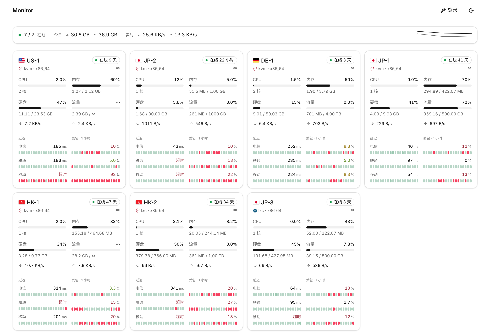
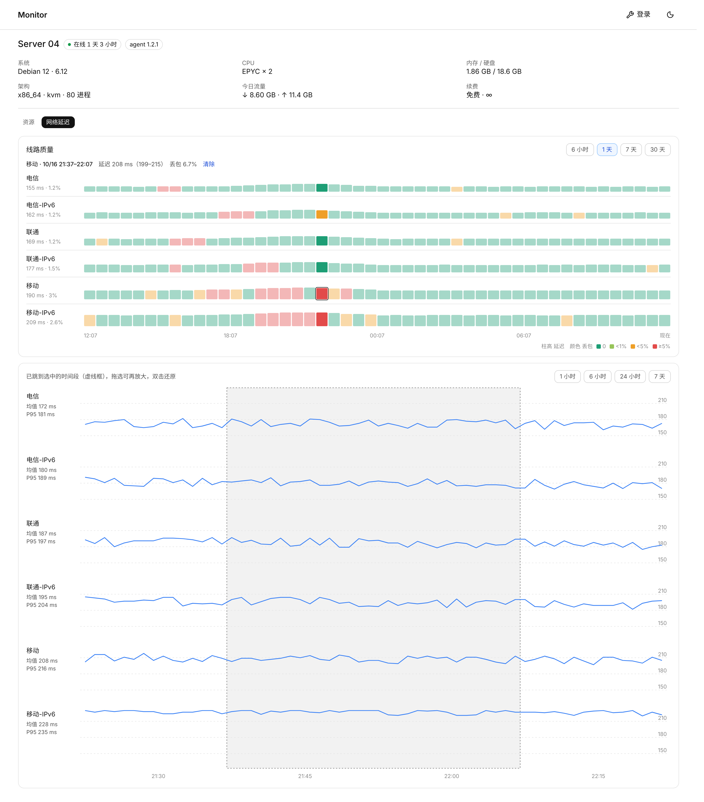

# K23Flux-monitor-theme-ping

[monitor](https://github.com/monitor-probe/monitor) 公开页主题，在官方默认主题 [monitor-theme-default](https://github.com/monitor-probe/monitor-theme-default) 1.4.1 上改出来，加了**延迟和丢包率**：

- **首页**：每张节点卡片底部显示 IPv4 测试，每个测试一行，左边是最新延迟和延迟色块，右边是丢包率和丢包色块，样式照 [Theme-Glassmorphism](https://github.com/Gongsc/Theme-Glassmorphism) 的卡片延迟。
- **详情页**：「网络延迟」页签分上下两块，外观和交互照 `probe-redesign-reference.html`（2026-10-17 定的样式）：
  - **线路质量**：每个测试一排细柱（IPv6 紧跟在同运营商的 IPv4 后面），柱高是该格平均延迟（140–230 ms 对应 30%–100%），颜色是该格丢包率（0 绿、<1% 浅绿、<5% 橙、≥5% 红）。范围 6 小时 / 1 天 / 7 天 / 30 天（hub 保留不够的档位不显示），手机格子更粗。悬停（手机点按）在信息行看该格延迟、最低–最高和丢包。
  - **延迟曲线**：每个测试各一行，共用时间轴，蓝色均值线加桶内最低–最高浅带。范围 1 / 6 / 24 小时、7 天；电脑拖选放大（最少 10 分钟），双击还原。
  - **联动**：点柱子，曲线跳到那一格的时间段并用虚线框标出；再点同一根、点「清除」或双击曲线取消。

其余和默认主题一样：React + Vite + shadcn/ui，黑白配色，只有延迟、丢包、在线状态和网速图的上下行带颜色。





## 安装

1. 后台「主题」→ 从 GitHub 安装，填 `https://github.com/K23Flux/K23Flux-monitor-theme-ping`。
2. 装好后在同一页设为当前主题。之后有新版本，点「从 GitHub 更新」。

主题短名是 `default-ping`，和内置默认主题并存，不会替换它。也可以手动安装：下载 Release 里的 `theme.tar.gz`，解压到 hub 的 `--themes` 目录下的 `default-ping/`。

## 后台设置

在后台「主题」页修改：

| 设置 | 默认 | 说明 |
|---|---|---|
| 显示汇总 | 开 | 节点列表上方的四格汇总（原版就有） |
| 卡片显示延迟 | 开 | 关掉后卡片和原版一样 |
| 卡片显示的延迟测试 | 空 | 每行一个，填后台「延迟测试」的名称或 ID，按填写顺序显示。留空时显示全部 IPv4 测试 |
| 卡片统计窗口 | 1 小时 | 卡片上的丢包率和色块覆盖的时间，可选 1 / 3 / 6 / 24 小时 |

详情页始终列出该节点的全部测试，统计窗口跟着页面上选的时间范围（1 小时、6 小时、1 天……）走。

## 测试名称怎么写

测试名称以 `-IPv6`、`IPv6` 或 `v6` 结尾（可带括号或空格，不分大小写），就算 IPv6 测试；其余算 IPv4。去掉后缀后名称相同的两个测试是一对，例如 `电信` 和 `电信-IPv6`：

- 首页默认只显示 `电信`；
- 详情页里 `电信-IPv6` 紧跟在 `电信` 下面，两条曲线同色，IPv6 用虚线。

## 数字和颜色怎么来的

- **延迟数字**：最新一个采样桶的中位数；最新一桶全部超时就显示「超时」。
- **丢包率**：hub 按整个窗口算好的丢包率（接口返回的 `loss`），不用每桶百分比自己平均，否则会算错。
- **平均 / 波动**（详情页）：窗口内各桶中位数的平均值、最低值和最高值。
- **色块**（首页卡片）：把窗口平均切成 20 格，每格取落在里面的采样：延迟取平均，全部超时记为最差；丢包取平均。没有采样的格子显示为灰色。
- **颜色分五档**，1 最好、5 最差：
  - **丢包**看数字本身，阈值沿用 Glassmorphism：≤ 1%、≤ 3%、≤ 6%、≤ 9% 依次为 1 到 4 档，更高为 5 档（红）。
  - **延迟**和这条线自己的常态比，不看绝对毫秒。常态是窗口内各桶中位数的中位数；高出常态的比例（再除以常态，常态低于 30 ms 按 30 ms 算）≤ 25%、≤ 60%、≤ 120%、≤ 200% 依次为 1 到 4 档，更高为 5 档。超时一律 5 档。这样从国内测美国、德国，二三百毫秒是正常的，整条不会一片红，只有明显比平时慢才变色。
- **节点离线**：卡片边框变红；从没接入过的节点不算。

- **请求**：首页每个节点大约每分钟读一次 `/api/nodes/{id}/metrics?series=ping&hours=N&points=60`，同时最多发 2 个。hub 同时只受理 4 个历史查询，超出直接返回 503，所以这里排队，遇到 503 会稍后重试。页面切到后台时停止刷新。

## 更新记录

- **1.1.1**（2026-10-17）：延迟曲线画出全部测试（1.1.0 只画了排在最前的电信 v4 / v6）；README 详情页截图换成新界面。
- **1.1.0**（2026-10-17）：详情页「网络延迟」改版，照 `probe-redesign-reference.html` 搬渲染和交互（`src/lib/probeRedesign.js`），只重写数据层（`src/lib/probeData.ts`）。原来的线路列表（延迟 / 丢包两排色块）、叠线延迟图和拖选条、削峰开关去掉。数据层把 hub 的记录铺成每分钟：最近 24 小时用 1 分钟桶，7 天内用 7 分钟桶，更早用小时汇总；粗桶按 band 和丢包率展开到每分钟。30 天档的丢包读的是小时汇总（hub 已向上取整），可能偏高最多约 1 个百分点。首页卡片不变。
- **1.0.1**（2026-10-16）：
  - 延迟颜色改为和线路自己的常态比，远距离线路不再整条红色（见上面「数字和颜色怎么来的」）。
  - 去掉节点卡片 CPU 下面的系统负载数字，核数移到进度条下面。LXC 容器里读到的是宿主机整机的负载（几百甚至上千），不是这台机器自己的。
  - 去掉汇总里的「最忙节点」，顶部剩节点、今日流量、实时网速三格。
  - 节点卡片的两行流量标上「实时」「累计」。
  - 离线节点的卡片边框变红。
  - 网速图：上行橙、下行蓝，图例说明实线是平均、虚线是峰值，峰值阴影调淡；修好纵轴顶部标签被截掉的问题。
- **1.0.0**（2026-10-16）：基于默认主题 1.4.1，加首页 IPv4 延迟 / 丢包、详情页全部测试的线路列表；延迟图按运营商着色，IPv6 用虚线；列表兼作图例，点击一行可以在图中隐藏或显示那条线。

## 开发

下面几节（开发、主题包、主题契约）沿用原版默认主题的说明。

主题只读公开数据，开发服务器直接拿一个现成的 hub 当数据源，要求它开着公开状态页：

```bash
npm ci
# Vite 将 /api 与 WebSocket 代理至这个 hub
MONITOR_HUB=https://hub.example.com npm run dev
```

不设 `MONITOR_HUB` 时代理至 `http://127.0.0.1:9911`。在本机起 hub、自己造节点的写法见文档站的
[主题开发](https://monitor-document.pages.dev/dev/theme)页。

构建产物位于 `dist/`。提交前运行 `npm run build && npm run lint && npm test`。

`npm test` 校验数字格式化、坐标轴与时间刻度、实时指标的输入边界，以及延迟测试的选择、IPv4 / IPv6 配对、色块分格和颜色分档。没有测试框架，Node 自己剥掉
类型，失败时退出码非零。

## 主题包

一个可安装主题是一个目录，名字必须与 `theme.json` 的 `short` 相同：

```text
<themes-dir>/<short>/
├── theme.json
├── preview.png        # 可选，面板上的预览图
└── dist/
    └── index.html
```

`theme.json` 除 `config` 外的六个字段都要写，均为字符串，`description`、`version`、`author`、`url` 可以留空，少写一个 hub 就不认这个主题：

| 字段 | 含义 |
|---|---|
| `name` | 显示名称 |
| `short` | 唯一短名，限字母、数字、`-`、`_`，取 `default` 则顶替 hub 内置的那份 |
| `description` | 简介 |
| `version` | 主题版本 |
| `author` | 作者 |
| `url` | 源码地址 |
| `config` | 可选，数组，站长在后台可调的设置，后台按它画表单 |

每个 tag 的 release 里的 `theme.tar.gz` 解开就是这个目录——hub 构建时嵌入的是同一个包。

将目录复制到 hub 的 `--themes` 位置，在后台「主题」页切换，无需重启。

## 主题契约

主题是纯静态 SPA，只能依赖下列同源接口：

| 接口 | 用途 |
|---|---|
| `GET /api/me` | 站点名、登录状态、公开页开关、历史保留天数 |
| `GET /api/nodes` | 节点列表、实时指标和累计流量 |
| `GET /api/nodes/{id}/metrics` | 历史指标和延迟记录 |
| `GET /api/ws` | 每 2 秒推送一次节点快照的 WebSocket；带 `?gzip` 时每帧 gzip 后以二进制消息发出 |
| `GET /api/themes/{short}/config` | 站长改过的主题设置，只含与默认值不同的项 |

主题自带设置界面时，站长登录后可以 `PUT` 同一地址保存。`config` 的声明格式、两个接口的规则与约定见文档站的[主题开发](https://monitor-document.pages.dev/dev/theme#主题设置)。

`metrics` 的三个查询参数都可省：

- `hours=N` 窗口宽度。**上限是 hub 的保留天数**（`/api/me` 的 `history_days`），登录与匿名相同，超出
  静默 clamp，所以档位要按它生成。7 天以内取分钟明细，更宽取每小时的汇总
- `points=W` 调用方画得下的点数，只会让 hub 抽得更稀，不会更密
- `series=metrics|ping` 只取要画的那一半，省掉的那半原本占响应的三分之一到三分之二

探测曲线的名字在响应的 `probes` 里随样本一起下发，匿名可读，所以画延迟图不需要第二个请求，也不
需要管理员身份。

整个窗口的丢包率在响应的 `loss` 里，按探测 id 给出百分比，没丢包的探测不出现。**不要拿样本行里
的 `loss` 自己平均**：那一个是所在桶的百分比，除数已经丢了，而各桶样本数天然不等——窗口首尾两桶
本来就是残缺的，探测启停、节点掉线、agent 跳过一轮都会再造几个。十三次里丢一次，平均桶百分比会
算出 50%。

匿名访问 `GET /api/nodes` 仅返回 `public=1` 的节点，响应中不含 `ip`、`hostname`、`remark`。字段定义以 hub 的 `src/api.rs` 为准。

未知路径回落到主题的 `dist/index.html`，客户端路由可用。`/admin/*` 由 hub 内置后台接管，不属于主题契约。

本主题用 `/node/{id}` 作为详情页。hub 的回落对它够用，但**hub 前面若有按路径做正向白名单的反代
或 WAF，得把这个前缀放行**：从列表点进去只是 pushState，边缘看不见，刷新详情页才会真的请求
`/node/{id}`，症状是「点进去正常，一刷新就被拦」。
图标 `/favicon.svg` 和 `/apple-touch-icon.png` 同样要放行，后者被拦时 iOS 收藏和添加到主屏幕都没有图标。

## 许可

MIT。原版默认主题版权归 stqfdyr，本仓库的改动版权归 K23Flux。
